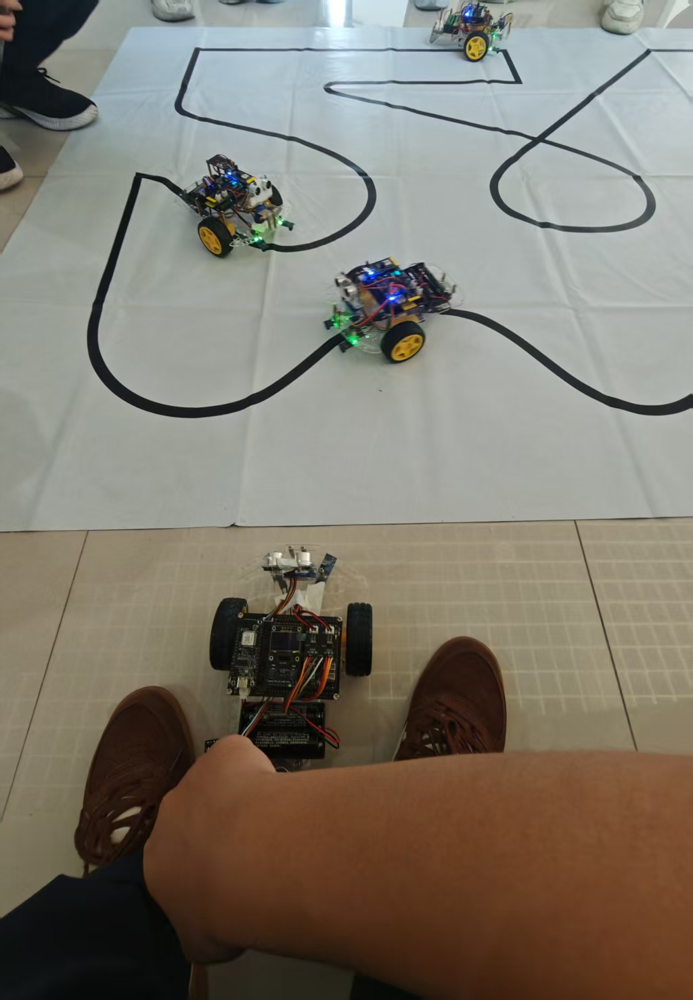

\# hi3861-oh-smart-car

基于Hi3861 WiFi IoT套件的OpenHarmony综合智能小车完整工程

\## 硬件组成

Hi3861开发板、直流减速电机底盘、L298N驱动、两路红外循迹传感器、SG90舵机、HC-SR04超声波、0.96寸SSD1306 OLED、蓝牙BLE模块

\## 项目功能

1\. \*\*红外自动循迹\*\*：trace\_model.c 实现黑线轨迹识别，自动修正行驶方向

2\. \*\*电机整车控制\*\*：支持前进/后退/左右转向/调速，舵机控制摄像头转向

3\. \*\*超声波避障\*\*：实时测距，前方障碍物自动停车避让

4\. \*\*OLED屏幕显示\*\*：小车运行状态、距离、运行模式实时打印

5\. \*\*蓝牙手机遥控\*\*：串口APP下发指令控制小车运动

6\. \*\*MQTT物联网远程控制\*\*：WiFi联网，网页端远程下发控制指令，云端上报小车状态

\## 代码模块说明

\### drivers/ 底层硬件驱动

\- motor：整车电机运动控制接口

\- ir\_trace：红外循迹采样与轨迹判断算法

\- sg90\_servo：SG90舵机PWM角度控制

\- hcsr04\_ultrasonic：超声波测距读取

\- oled\_ssd1306：SSD1306 I2C屏幕驱动，状态显示

\### mqtt\_client/ 物联网模块

\- paho-mqtt 底层MQTT协议库

\- mqtt\_control：小车MQTT发布/订阅逻辑

\- mqtt\_web.html：本地网页控制界面

\## 编译烧录步骤

1\. 将本仓库放入OpenHarmony `applications/sample/wifi-iot/app/`

2\. `hb set` 选择 `wifiiot\_hispark\_pegasus`

3\. `hb build -f` 编译完整镜像

4\. HiBurn烧录，串口查看小车运行日志

\## 配套基础实验仓库

GPIO/ADC/WiFi/MQTT/OLED单项入门Demo：

https://github.com/3487948775chen-hash/hi3861-oh-demos

\## License

MIT

