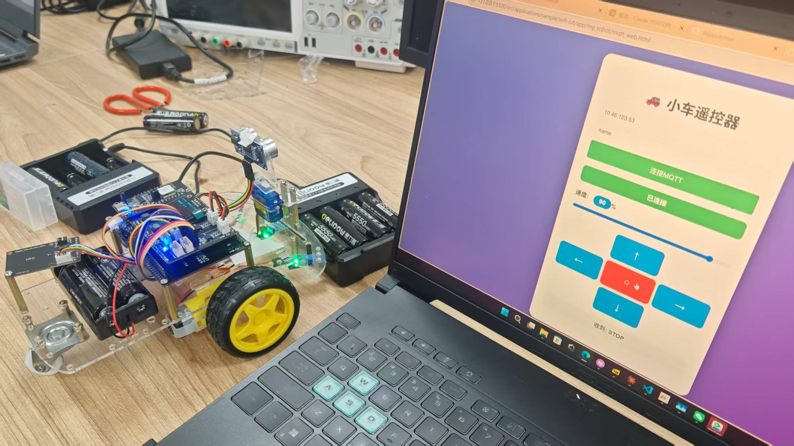

 <p align="center">
  <b>OpenHarmony Hi3861 综合智能小车</b>
  <br>
  基于 Hi3861 WiFi IoT 开发套件 · OpenHarmony LiteOS-M · C Language
</p>

<p align="center">
  
  
  
  
  
  
</p>

## 1. 项目介绍

本项目是基于 Hi3861 WiFi IoT 开发套件和 OpenHarmony LiteOS-M 系统实现的综合智能小车项目，属于电子工艺实训课程的拓展实践。

项目以 Hi3861 为主控，集成红外循迹、电机驱动、超声波测距、舵机控制、OLED 显示、蓝牙遥控及 MQTT 物联网通信等功能，实现一套集自主运动、环境感知和远程控制于一体的智能小车系统。

在软件设计上，将底层硬件驱动、运动控制、循迹逻辑和物联网通信进行模块化组织，使不同功能模块能够相对独立地开发与调试。

**项目主要功能：**

- 双路红外扫雷模式循迹：通过两路红外传感器识别黑线轨迹，实现自动循迹。
- 电机运动控制：支持前进、后退、左右转向及速度调节。
- 超声波避障：实时检测前方障碍物距离，实现自动停车避让。
- 舵机控制：通过 SG90 舵机控制摄像头转向。
- OLED 状态显示：实时显示小车运行状态、距离及运行模式。
- 蓝牙手机遥控：通过手机串口 APP 下发控制指令。
- MQTT 远程控制：通过 WiFi 和网页端实现远程控制及状态上报。

<badge color="success">课程成绩：满绩点</badge>

## 2. Hardware & Development Environment

### 硬件组成

| 硬件模块 | 主要用途 |
|---|---|
| HiSpark Pegasus Hi3861V100 | 主控芯片及 OpenHarmony 运行平台 |
| 直流减速电机底盘 | 小车运动执行机构 |
| L298N 电机驱动模块 | 直流电机驱动与方向控制 |
| 两路红外循迹传感器 | 黑线检测与自动循迹 |
| SG90 舵机 | 摄像头转向控制 |
| HC-SR04 超声波模块 | 前方障碍物距离检测 |
| SSD1306 OLED | 小车状态与测距信息显示 |
| 蓝牙 BLE 模块 | 手机无线遥控 |

### 软件开发环境

| 类别 | 配置 |
|---|---|
| 主控平台 | Hi3861V100 |
| 操作系统 | OpenHarmony LiteOS-M 4.0 |
| 编程语言 | C |
| 编译工具 | hb build |
| 烧录工具 | HiBurn |
| 调试工具 | 串口 Monitor |
| 网络通信 | WiFi / MQTT |
| 本地控制 | Bluetooth BLE |

## 3. Project Structure

```text
hi3861-oh-smart-car/
│
├── docs/
│   ├── car_experiment.docx
│   ├── hardware_img1.jpg
│   └── hardware_img2.jpg
│
├── drivers/
│   ├── hcsr04_ultrasonic/
│   │   └── robot_hcsr04.c
│   │
│   ├── ir_trace/
│   │   └── trace_model.c
│   │
│   ├── motor/
│   │   └── robot_control.c
│   │
│   ├── oled_ssd1306/
│   │   ├── ssd1306.c
│   │   ├── ssd1306.h
│   │   ├── ssd1306_conf.h
│   │   ├── ssd1306_fonts.c
│   │   ├── ssd1306_fonts.h
│   │   ├── robot_sg90.c
│   │   └── robot_sg90_mid.c
│   │
│   └── mqtt_client/
│       ├── mqtt_control.c
│       └── mqtt_control.h
│
├── mqtt_client/
│   ├── mqtt_control.c
│   ├── mqtt_control.h
│   ├── mqtt_web.html
│   └── paho-mqtt-min.js
│
├── BUILD.gn
├── README.md
└── my_robot.zip
```

各模块按照功能进行划分，主要包括底层外设驱动、电机运动控制、循迹算法及 MQTT 通信。

## 4. 核心功能

### 4.1 双路红外扫雷模式循迹

**核心模块：** `drivers/ir_trace/trace_model.c`

小车采用两路红外循迹传感器，使用扫雷模式实现黑线轨迹识别与自动循迹。

**实现内容：**

- 使用两路红外传感器采集路面状态。
- 根据两路传感器的检测结果判断当前循迹状态。
- 通过扫雷模式循迹逻辑识别黑线轨迹。
- 结合电机控制模块调整小车行驶方向，实现自动循迹。

**涉及技术：** 红外传感器信号采集、双路传感器状态判断、循迹逻辑、电机运动控制。

### 4.2 电机运动控制

**核心模块：** `drivers/motor/robot_control.c`

通过 L298N 电机驱动模块控制直流减速电机，实现小车运动控制。

**实现功能：**

- 小车前进与后退。
- 左转与右转。
- 电机速度调节。
- 配合循迹模块完成自动运动控制。

**涉及技术：** GPIO 控制、PWM 调速、电机驱动、运动控制逻辑。

### 4.3 超声波避障

**核心模块：** `drivers/hcsr04_ultrasonic/robot_hcsr04.c`

使用 HC-SR04 超声波模块获取小车前方障碍物距离，实现基础避障功能。

**实现功能：**

- 通过超声波模块进行距离测量。
- 获取前方障碍物距离信息。
- 根据测距结果控制小车停车避让。

**涉及技术：** 超声波测距、时序控制、距离计算、避障逻辑。

### 4.4 SG90 舵机控制

**相关模块：** `robot_sg90.c`、`robot_sg90_mid.c`

使用 SG90 舵机实现摄像头转向控制。

**实现内容：**

- 通过 PWM 信号控制舵机。
- 调整舵机转动角度。
- 实现摄像头方向调整。

**涉及技术：** PWM 信号、舵机角度控制。

### 4.5 SSD1306 OLED 状态显示

**核心模块：** `drivers/oled_ssd1306/`

使用 0.96 英寸 SSD1306 OLED 显示屏，为小车提供运行状态显示功能。

**实现内容：**

- 显示小车运行状态。
- 显示超声波测量距离。
- 显示当前运行模式。

**涉及技术：** I2C 通信、SSD1306 驱动、OLED 图形与字符显示。

### 4.6 蓝牙手机遥控

通过蓝牙 BLE 模块实现手机端与小车之间的无线控制。

**实现功能：**

- 手机 APP 发送控制指令。
- 小车接收串口指令。
- 根据指令控制小车运动。

**涉及技术：** BLE 无线通信、串口数据接收、指令解析、电机控制。

### 4.7 MQTT 物联网远程控制

**核心模块：** `mqtt_client/`

在 OpenHarmony WiFi 网络连接基础上，使用 MQTT 协议实现小车与远程网页端之间的消息交互。

**系统功能：**

- 通过 WiFi 接入网络。
- 使用 Paho MQTT 客户端库实现 MQTT 通信。
- 通过 MQTT 订阅远程控制指令。
- 通过 MQTT 发布小车状态信息。
- 使用 HTML 网页作为远程控制界面。

**通信架构：**

```text
        Web Control Interface
             │
             ▼
         MQTT Client
             │
             ▼
         MQTT Broker
             │
             ▼
       WiFi Network
             │
             ▼
       Hi3861 Board
             │
       ┌─────┴─────┐
       ▼           ▼
   Motor Control  Status Feedback
       │
       ▼
    Smart Car
```

**涉及技术：** WiFi、MQTT、Paho MQTT、消息订阅与发布、HTML 网页控制。

## 5. Hardware Demonstration

项目配套硬件实拍图片，记录小车整体搭建与实际运行情况。

<p align="center">
  
  
</p>

## 6. 编译与烧录

### 6.1 环境准备

准备 OpenHarmony 源码环境，并配置 Hi3861 HiSpark Pegasus 开发板对应的编译工具链。

### 6.2 导入项目

将本仓库放入 OpenHarmony 源码目录：

```bash
applications/sample/wifi-iot/app/
```

### 6.3 选择开发板

在 OpenHarmony 源码根目录执行：

```bash
hb set
```

选择目标开发板：

```text
wifiiot_hispark_pegasus
```

### 6.4 编译工程

执行全量编译：

```bash
hb build -f
```

### 6.5 烧录与调试

1. 使用 HiBurn 烧录生成的固件镜像。
2. 连接开发板串口。
3. 使用串口 Monitor 查看程序运行日志。
4. 完成小车硬件连接并进行功能测试。

## 7. 配套资料

`docs/car_experiment.docx`

小车综合实验记录，配套记录项目设计与实验过程。

`docs/hardware_img1.jpg`、`docs/hardware_img2.jpg`

小车硬件实拍图片。

## 8. 关联项目

**hi3861-oh-demos**

Hi3861 OpenHarmony 基础实验代码仓库。

包含 GPIO、ADC、OLED、WiFi STA 和 MQTT 等基础实验，为本项目提供外设与网络通信方面的学习基础。

GitHub：

https://github.com/3487948775chen-hash/hi3861-oh-demos

## 9. 技术积累

通过本项目，综合实践了以下嵌入式开发技术：

- **OpenHarmony LiteOS-M：** 基于 OpenHarmony 系统进行嵌入式应用开发。
- **GPIO 与传感器：** 红外循迹、超声波测距及外设信号采集。
- **电机控制：** 直流电机驱动、PWM 调速及运动控制。
- **循迹算法：** 基于双路红外传感器的扫雷模式循迹。
- **舵机控制：** PWM 控制 SG90 舵机转动。
- **显示驱动：** I2C 通信及 SSD1306 OLED 驱动。
- **无线通信：** 蓝牙遥控及 WiFi 网络连接。
- **物联网通信：** MQTT 消息订阅、发布及网页远程控制。
- **模块化设计：** 将硬件驱动、运动控制、循迹与网络通信进行功能划分。

## 10. 课程成绩

本项目对应电子工艺实训课程。

**课程成绩：满绩点。**

通过课程实验与综合小车项目实践，完成了从基础外设控制到多模块协同工作的嵌入式系统开发训练。

## 11. License

This project is licensed under the MIT License.

---

<p align="center">
  <b>Author: Still</b>
  <br>
  OpenHarmony · Hi3861 · Embedded IoT
</p>
